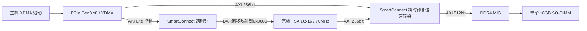

# NP19A 板级迁移设计与验证

## 来源与边界

`original-np19a` 从 `original-nm37-civ` 的 `87cd26500fc88f7051771e3cb1670001375c6b1f` 建立，复用已物化的原始 FSA/easyfloat 和依赖锁。这里的“original”表示原始计算架构，不是从上游任意最新 commit 开始。该父分支保留历史 Python 正确性修复；NP19A 不引入 P3/ShiftRightJam 优化或新增 PE 流水。可用 `git diff 87cd2650 -- generators/fsa generators/easyfloat` 确认核心无改动。

用户提供的 XDC/Tcl 原文及 SHA256 保存在 `docs/history/NP19A/`。参考 NEXST `cc81d9363efc27f2a1ef2ebe9005c575daf21596` 的 NP19A PCIe/DDR 配置，但不引入香山、Root Port、CPU启动流程或调试系统。用户明确型号 `xcvu19p-fsva3824-2-e` 优先于示例工程中的型号/速度级。原理图仅辅助核对；实际安装的 SO-DIMM 型号、容量和时钟仍需板卡持有人确认。

## 结构

- `fpga/src/main/scala/np19a/NP19AFSACore.scala`：独立 AXI4 控制从接口和 AXI4 访存主接口；原始 AXI4FSA 保持不变。使用 UserYanker 的每 ID flight cap8，明确限制未携带 user 的在途事务。
- `scripts/np19a/wrap_axi.py`：将 Chisel 信号命名转换为 Vivado AXI 接口属性；不增加时钟拍。控制接口主机地址0…0xff映射至内部0x8000…0x80ff。XDMA BAR translation必须64KB对齐，不能直接写0x8000，因此使用地址高位重映射；SmartConnect只开放首4KB控制窗口。其余信号逐一连接，未知端口即报错。
- `scripts/np19a/implement.tcl`：创建 BD、IP、地址映射、时钟复位、综合、布局布线和报告。不使用 HBM。
- `scripts/np19a/top.xdc`：从用户约束筛选 DDR4、DDR参考钟、PCIe参考钟和PERST；移除香山Root Port、RTC、LED等未使用端口。PCIe lane位置由XDMA指定GT Quad/PCIe block生成约束。

## 参数

| 项目 | 设置及含义 |
|---|---|
| FPGA | xcvu19p-fsva3824-2-e |
| 工具 | Vivado2024.2；其他版本见环境文档 |
| PCIe | Endpoint，Gen3 x8，PCIE4C_X0Y2、GTY_Quad_226；1个H2C/1个C2H通道 |
| 控制口 | XDMA AXI Lite → SmartConnect → 原始FSA AXI4控制口 |
| 计算时钟 | 外部100MHz → clk_wiz → 70MHz |
| DDR型号 | MTA16ATF2G64HZ-2G3，16GB、x64、双rank，无ECC |
| DDR输入周期 | 10005ps（参考示例）；板级参考钟约束10ns |
| DDR数据周期 | 938ps；不是“DDR控制器300MHz” |
| MIG AXI | 512bit / 34bit地址；启用AXI及窄突发 |
| 原始FSA访存 | 256bit / 16GB地址空间 / 单端口 |
| CS/BG宽度 | 由MIG内存型号派生为2；不强制使用示例片段中的1 |
| 内部存储 | 原始scratchpad/accumulator配置保持不变 |

不能从容量和频率推断与HBM相同的性能。DDR4只有一个通道，DMA排队与bubble需要实板测量；不同板卡必须使用相同序列、随机种子和计算配置比较。

## 复位和启动

PCIe PERST反相后复位MIG与PLL。MIG校准完成、XDMA AXI复位释放共同决定FSA/互连启动；`proc_sys_reset`在目标域同步释放。MIG的AXI复位由UI域独立同步。SmartConnect承担PCIe、70MHz核心和DDR UI时钟域之间的AXI跨域，不能用简单总线寄存器替代。

如果校准一直不完成，FSA保持复位；软件控制请求可能阻塞。初次调试应先在Vivado检查DDR校准、PLL锁定和PCIe link，而不是反复发attention。运行期间PCIe热复位会丢失正在执行的任务；重新初始化软件与任务，不支持跨复位继续执行。

## 验证记录

开发输出在独立工作目录，保留失败日志。当前完成：生成器编译、16×16原始FSA RTL展开、AXI包装层生成。正在验证BD与后续完整实现，**暂不声明静态时序或上板通过**。

已修复的迁移问题：

1. 原Chipyard流程要求模型/DUT层次不同：NP19AFSACore为模型，AXI4FSA为DUT；不能使用并不存在的EmptyChipTop或把二者设成同一模块。
2. 原始AXI访存的UserYanker需要显式flight cap，采用既有cap8。
3. XDMA BAR转换不允许0x8000；通过板级包装层实现原始寄存器协议重映射。
4. proc_sys_reset辅助复位默认低有效，接常数1保持非有效；脚本检查派生极性。
5. 外部共享IBUFDS已经缓冲100MHz参考钟，Clock Wizard必须设置PRIM_SOURCE=No_buffer，避免重复输入缓冲。
6. sbt-assembly2.1.1在更换输出目录时可能复用旧路径的assembly缓存；关闭assembly输出缓存（保留依赖和编译缓存），并以非空JAR检查替代touch，防止创建空JAR伪装成功。

最终通过程度以新的验证报告及真实产物为准；未完成的DDR校准、PCIe链路、实际attention数值与性能必须在NP19A实板验收。
